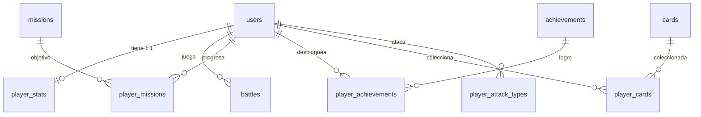

# Base de Datos — Elemental Battlecards (PostgreSQL)

Guía de estudio de todas las tablas del juego, sus columnas, relaciones y datos iniciales.

- **Motor:** PostgreSQL 18 (la BD por defecto se llama `elemental`).
- **Script de creación:** `Backend/sql/schema.sql` (idempotente, se puede re-ejecutar).
- **Modelos Sequelize:** `Backend/src/database/models/` (definen las mismas tablas para el backend).
- La tabla `users` la gestiona **Sequelize** (`sync({alter:true})`); el resto las crea `schema.sql`.

---

## 1. Resumen

| # | Tabla | Qué guarda | Llave primaria |
|---|-------|-----------|----------------|
| 1 | `users` | Cuentas de jugador | `id` |
| 2 | `cards` | Catálogo de 18 cartas (6 tipos × 3 niveles) | `id` |
| 3 | `player_stats` | Estadísticas agregadas por jugador | `user_id` |
| 4 | `battles` | Historial de partidas | `id` |
| 5 | `missions` | Catálogo de misiones | `id` (texto) |
| 6 | `player_missions` | Progreso de misiones por jugador | `(user_id, mission_id)` |
| 7 | `achievements` | Catálogo de logros | `id` (texto) |
| 8 | `player_achievements` | Logros desbloqueados por jugador | `(user_id, achievement_id)` |
| 9 | `player_cards` | Colección de cartas por jugador | `(user_id, card_id)` |
| 10 | `player_attack_types` | Tipos elementales con los que ha atacado | `(user_id, element)` |

**Elementos canónicos** (tipos de cartas): `fuego`, `agua`, `planta`, `luz`, `sombra`, `espiritu`.

**Objetos adicionales en la BD** (ver secciones 3 a 6):

| Objeto | Nombre | Cantidad |
|--------|--------|----------|
| Vistas | `v_ranking_jugadores`, `v_coleccion_cartas`, `v_progreso_misiones`, `v_historial_batallas` | 4 |
| Procedimientos almacenados | `sp_registrar_batalla`, `sp_completar_mision` | 2 |
| Trigger | `trg_stats_batalla` (sobre `battles`) | 1 |

Scripts SQL en esta carpeta: `schema.sql` → `vistas.sql` → `triggers.sql` → `procedimientos.sql` → `datos_demo.sql` (en ese orden).

---

## 2. Tablas

### 2.1 `users` — Cuentas (gestionada por Sequelize)

| Columna | Tipo | Restricción | Descripción |
|---------|------|-------------|-------------|
| `id` | `integer` | PK, autoincremento | Identificador |
| `username` | `varchar(255)` | NOT NULL, UNIQUE | Nombre de usuario (usado para login) |
| `email` | `varchar(255)` | NOT NULL, UNIQUE | Correo electrónico |
| `password` | `varchar(255)` | NOT NULL | Hash bcrypt |
| `createdAt` | `timestamptz` | NOT NULL | Fecha de alta |
| `updatedAt` | `timestamptz` | NOT NULL | Última modificación |

### 2.2 `cards` — Catálogo de cartas

| Columna | Tipo | Restricción | Descripción |
|---------|------|-------------|-------------|
| `id` | `integer` | PK, autoincremento | Identificador |
| `element` | `varchar(20)` | NOT NULL, CHECK ∈ 6 tipos | Elemento de la carta |
| `level` | `smallint` | NOT NULL, CHECK 1–3 | Nivel de la carta |
| `name` | `varchar(60)` | NOT NULL | Nombre (p. ej. "Fuego II") |

- Unicidad: `UNIQUE (element, level)` → 6 × 3 = **18 cartas**.
- Se llena solita con `INSERT ... ON CONFLICT DO NOTHING` del `schema.sql`.

### 2.3 `player_stats` — Estadísticas del jugador (1:1 con `users`)

| Columna | Tipo | Restricción | Descripción |
|---------|------|-------------|-------------|
| `user_id` | `integer` | PK, FK → `users(id)` ON DELETE CASCADE | Jugador |
| `battles_played` | `integer` | NOT NULL, default 0 | Partidas jugadas |
| `battles_won` | `integer` | NOT NULL, default 0 | Victorias |
| `battles_lost` | `integer` | NOT NULL, default 0 | Derrotas |
| `current_streak` | `integer` | NOT NULL, default 0 | Racha actual de victorias |
| `longest_streak` | `integer` | NOT NULL, default 0 | Racha máxima histórica |
| `gems` | `integer` | NOT NULL, default 0 | Gemas acumuladas (recompensas) |
| `updated_at` | `timestamptz` | NOT NULL, default `now()` | Última actualización |

> Nivel, XP y ranking **no** se guardan: se calculan derivados de `battles_won`
> (nivel = 1 + floor(victorias×100 / 300)).

### 2.4 `battles` — Historial de partidas

| Columna | Tipo | Restricción | Descripción |
|---------|------|-------------|-------------|
| `id` | `integer` | PK, autoincremento | Identificador |
| `user_id` | `integer` | NOT NULL, FK → `users(id)` CASCADE | Jugador |
| `result` | `varchar(10)` | NOT NULL, CHECK ∈ (`victoria`,`derrota`) | Resultado |
| `opponent` | `varchar(10)` | NOT NULL, default `bot`, CHECK ∈ (`bot`,`lan`) | Rival |
| `difficulty` | `varchar(30)` | NULL | Dificultad del bot (1–10) |
| `level3_on_field` | `boolean` | NOT NULL, default `false` | Ganó con carta nivel 3 en campo |
| `created_at` | `timestamptz` | NOT NULL, default `now()` | Cuándo se jugó |

- Índices: `idx_battles_user`, `idx_battles_created`.

### 2.5 `missions` — Catálogo de misiones

| Columna | Tipo | Restricción | Descripción |
|---------|------|-------------|-------------|
| `id` | `varchar(40)` | PK | Slug (p. ej. `primera-victoria`) |
| `element` | `varchar(20)` | NOT NULL, CHECK | Elemento asociado |
| `title` | `varchar(80)` | NOT NULL | Título |
| `description` | `text` | NULL | Descripción |
| `target` | `integer` | NOT NULL, default 1 | Objetivo a alcanzar |
| `reward_gems` | `integer` | NOT NULL, default 0 | Recompensa (gemas) |

**Las 6 misiones precargadas:**

| id | título | objetivo | recompensa |
|----|--------|----------|------------|
| `primera-victoria` | Primera victoria | 1 | 50 |
| `coleccionista` | Coleccionista | 1 | 100 |
| `fusionador` | Fusionador | 5 | 150 |
| `racha-victorias` | Racha de victorias | 3 | 200 |
| `aprendiz-elemental` | Aprendiz elemental | 6 | 120 |
| `estratega` | Estratega | 1 | 250 |

### 2.6 `player_missions` — Progreso de misiones

| Columna | Tipo | Restricción | Descripción |
|---------|------|-------------|-------------|
| `user_id` | `integer` | PK, FK → `users(id)` CASCADE | Jugador |
| `mission_id` | `varchar(40)` | PK, FK → `missions(id)` CASCADE | Misión |
| `progress` | `integer` | NOT NULL, default 0 | Avance actual |
| `completed` | `boolean` | NOT NULL, default `false` | Completada |
| `completed_at` | `timestamptz` | NULL | Fecha de finalización |

### 2.7 `achievements` — Catálogo de logros

| Columna | Tipo | Restricción | Descripción |
|---------|------|-------------|-------------|
| `id` | `varchar(40)` | PK | Slug (p. ej. `primera-llama`) |
| `element` | `varchar(20)` | NOT NULL, CHECK | Elemento asociado |
| `title` | `varchar(80)` | NOT NULL | Título |
| `description` | `text` | NULL | Cómo desbloquearlo |

**Los 6 logros precargados:**

| id | título | condición |
|----|--------|-----------|
| `primera-llama` | Primera llama | 1 victoria |
| `marea-creciente` | Marea creciente | racha de 3 |
| `raices-profundas` | Raíces profundas | 5 fusiones |
| `cazador-del-viento` | Cazador del viento | todas las misiones |
| `coloso-invicto` | Coloso invicto | 10 victorias |
| `senor-de-la-noche` | Señor de la noche | 18 cartas coleccionadas |

### 2.8 `player_achievements` — Logros desbloqueados

| Columna | Tipo | Restricción | Descripción |
|---------|------|-------------|-------------|
| `user_id` | `integer` | PK, FK → `users(id)` CASCADE | Jugador |
| `achievement_id` | `varchar(40)` | PK, FK → `achievements(id)` CASCADE | Logro |
| `unlocked_at` | `timestamptz` | NOT NULL, default `now()` | Cuándo se desbloqueó |

### 2.9 `player_cards` — Colección de cartas

| Columna | Tipo | Restricción | Descripción |
|---------|------|-------------|-------------|
| `user_id` | `integer` | PK, FK → `users(id)` CASCADE | Jugador |
| `card_id` | `integer` | PK, FK → `cards(id)` CASCADE | Carta |
| `collected_at` | `timestamptz` | NOT NULL, default `now()` | Fecha de colección |

### 2.10 `player_attack_types` — Tipos atacados (misión "Aprendiz elemental")

| Columna | Tipo | Restricción | Descripción |
|---------|------|-------------|-------------|
| `user_id` | `integer` | PK, FK → `users(id)` CASCADE | Jugador |
| `element` | `varchar(20)` | PK, CHECK | Elemento con el que atacó |

---

## 3. Vistas (4)

| # | Vista | Qué resuelve | Técnica principal |
|---|-------|--------------|-------------------|
| 1 | `v_ranking_jugadores` | Ranking con partidas, victorias, % victorias, rachas y gemas | `LEFT JOIN` users + player_stats (incluye jugadores sin stats) + `CASE` |
| 2 | `v_coleccion_cartas` | Cuántos jugadores poseen cada carta y su % | `LEFT JOIN` + `COUNT` + `NULLIF` (evita división por 0) |
| 3 | `v_progreso_misiones` | Misiones con jugadores que la iniciaron/completaron y progreso promedio | `LEFT JOIN` + `COUNT(...) FILTER (WHERE ...)` + `AVG` |
| 4 | `v_historial_batallas` | Historial legible de batallas con username en lugar de id | `JOIN` battles + users, orden cronológico |

```sql
SELECT * FROM v_ranking_jugadores;
SELECT * FROM v_coleccion_cartas  WHERE poseedores > 0;
SELECT * FROM v_progreso_misiones;
SELECT * FROM v_historial_batallas LIMIT 10;
```

---

## 4. Procedimientos almacenados (2)

Se ejecutan con `CALL` y corren en **una transacción implícita** (o se aplican todos los pasos o ninguno).

| # | Procedimiento | Parámetros | Qué hace |
|---|---------------|-----------|----------|
| 1 | `sp_registrar_batalla` | `p_user_id, p_resultado, p_opponent, p_dificultad, p_nivel3_en_campo, p_elemento_ataque` | Valida dominio → INSERT en `battles` → registra el tipo de ataque en `player_attack_types` → devuelve por `NOTICE` las stats actualizadas (las mantiene el trigger) |
| 2 | `sp_completar_mision` | `p_user_id, p_mission_id` | Valida que usuario/misión existan → UPSERT de progreso completo en `player_missions` → acredita `reward_gems` en `player_stats.gems` (ambas escrituras en la misma transacción) |

```sql
-- Las CALL no aceptan subconsultas: usar valores directos o variables psql (\gset)
SELECT id AS kai FROM users WHERE username = 'demo_kai' \gset
CALL sp_registrar_batalla(:kai, 'victoria', 'bot', '5', false, 'agua');
CALL sp_completar_mision(:kai, 'primera-victoria');
```

---

## 5. Trigger (1)

**`trg_stats_batalla`** — `AFTER INSERT ON battles FOR EACH ROW` → ejecuta `fn_actualizar_stats_batalla()`:

```
INSERT en battles ──▶ trigger ──▶ UPSERT en player_stats
                                 (battles_played +1,
                                  battles_won/battles_lost +1 según result,
                                  current_streak +1 en victoria / 0 en derrota,
                                  longest_streak = máx histórico,
                                  updated_at = now())
```

- Si el jugador no tiene fila en `player_stats`, el trigger la crea.
- Alimenta en automático `v_ranking_jugadores` (las estadísticas nunca se desincronizan del historial).

---

## 6. Datos de demostración (`datos_demo.sql`)

Crea 4 usuarios `demo_*` (**contraseña: `demo1234`**) con progreso para que las vistas/procedimientos tengan filas que mostrar:

| Usuario | Batallas | Récord | Racha actual / mejor | Gemas |
|---------|----------|--------|----------------------|-------|
| `demo_kai` | 6 | 5V 1D (83.3%) | 2 / 3 | 350 |
| `demo_luna` | 5 | 3V 2D (60.0%) | 2 / 2 | 220 |
| `demo_ryo` | 4 | 1V 3D (25.0%) | 0 / 1 | 50 |
| `demo_zara` | 3 | 2V 1D (66.7%) | 1 / 1 | 180 |

- Además: 18 `player_cards`, 10 `player_missions` (5 completadas), 10 `player_attack_types`, 4 `player_achievements`.
- Las 18 batallas se insertan **en orden cronológico** para que el trigger derive bien las rachas; las stats NO se insertan a mano.
- Es idempotente (borra y re-crea los `demo_*`) y se elimina con `datos_demo_eliminar.sql` (un solo `DELETE` gracias a los `ON DELETE CASCADE`).

---

## 7. Diagrama de relaciones (ER)



```
users 1 ──── 1  player_stats        users 1 ──── N  battles
users 1 ──── N  player_missions ──── 1 missions
users 1 ──── N  player_achievements ─ 1 achievements
users 1 ──── N  player_cards ──────── 1 cards
users 1 ──── N  player_attack_types
```

Todas las FK usan `ON DELETE CASCADE`: borrar un usuario limpia todo su progreso.

---

## 8. Cómo regenerar la base

```powershell
# 1) Crear la BD (si no existe) y sincronizar modelos Sequelize
cd Backend
npm run db:init

# 2) Tablas + datos iniciales + vistas + trigger + procedimientos + demo
#    (ejecutar EN ESTE ORDEN; todos los scripts son idempotentes)
$env:PGPASSWORD='123456'
$psql = "C:\Program Files\PostgreSQL\18\bin\psql.exe"
& $psql -U postgres -h 127.0.0.1 -d elemental -f sql\schema.sql
& $psql -U postgres -h 127.0.0.1 -d elemental -f sql\vistas.sql
& $psql -U postgres -h 127.0.0.1 -d elemental -f sql\triggers.sql
& $psql -U postgres -h 127.0.0.1 -d elemental -f sql\procedimientos.sql
& $psql -U postgres -h 127.0.0.1 -d elemental -f sql\datos_demo.sql

# 3) (Opcional) borrar solo los datos demo
& $psql -U postgres -h 127.0.0.1 -d elemental -f sql\datos_demo_eliminar.sql
```

> **Nota:** `schema.sql` restaura los `DEFAULT now()` de las columnas de fecha
> porque `sequelize.sync({alter:true})` puede eliminarlos al arrancar el backend.

Consultas útiles de estudio:

```sql
-- Estado de un jugador y su progreso
SELECT u.username, s.battles_won, s.longest_streak
FROM users u JOIN player_stats s ON s.user_id = u.id;

-- Misiones completadas por el jugador
SELECT m.id, m.title, pm.progress, m.target, pm.completed
FROM player_missions pm
JOIN missions m ON m.id = pm.mission_id
WHERE pm.user_id = 1;

-- Cartas de un tipo en el catálogo
SELECT element, level, name FROM cards WHERE element = 'fuego';
```

---

## 9. Notas

- **Duplicidad de tipos:** el catálogo del frontend usa alias (`Naturaleza`, `Oscuridad`, `Aire`, `Tierra`); en la BD se guardan los **canónicos** (`planta`, `sombra`, `luz`, `espiritu`).
- Las tablas `cards`, `missions` y `achievements` son catálogos (no tienen `created_at`/`updated_at`).
- `player_stats` usa `user_id` como PK → garantiza una sola fila por jugador.