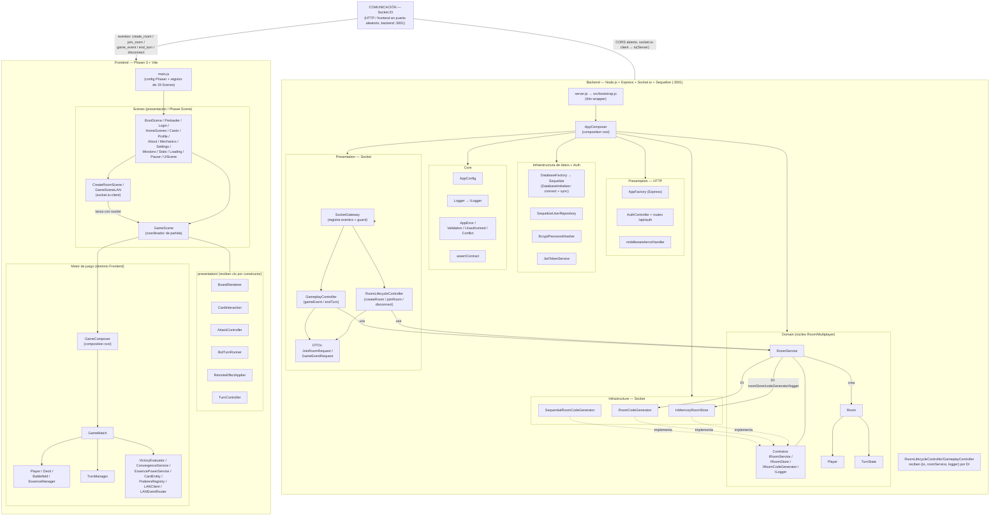

# Diagrama General de Arquitectura — Elemental Battlecards

> Diagrama generado a partir del código actual (sin modificar archivos).
> Representa los componentes reales de `Frontend/` y `Backend/`, sus capas y su comunicación vía Socket.IO.

---

## Explicación de cada bloque

### 1. Cliente / Frontend
- **main.js** — punto de entrada Phaser: define el `Game` (1600×1000, `Scale.FIT`, DOM container) y registra las 19 escenas. Solo coordina el arranque, sin lógica de negocio.
- **Scenes** — capa de presentación: cada una extiende `Phaser.Scene`. Las de menú (`HomeScenes`, `Cards`, `Profile`, etc.) son pantallas mayormente DOM; `CreateRoomScene`/`GameSceneLAN` son las únicas que crean el socket.io-client; todas navegan vía `scene.start` pasando `playerData`.
- **GameScene** — coordinador de partida: construye el objeto `ctx` (de 18 campos), instancia las 6 clases de `presentation/` (BoardRenderer, CardInteraction, AttackController, BotTurnRunner, RemoteEffectApplier, TurnController) y delega en `GameComposer` para crear el motor. No contiene lógica de negocio.
- **GameComposer** — *composition root* del Frontend: `createMatch()` → `GameMatch` (valida `IGameMatch.assert`), `createBot()` → `BotAI` (valida `IBotAI.assert`), `createLanStack()` → `LANClient` + `LANEventRouter` (valida `ISyncGateway.assert`).
- **GameMatch** — agregado raíz del motor: compone 2× `Player` (con `Deck`, `Battlefield`, `EssenceManager`), 1× `TurnManager` y 1× `EventBus`, y delega reglas en servicios estáticos (`VictoryEvaluator`, `ConvergenceService`, `PoderesRegistry`, `resolveCombat`).

### 2. Comunicación
- **Socket.IO** es el único canal entre apps. El frontend conecta con `io(SERVER_URL)` (URL derivada de `?backend=`, `window.BACKEND_URL` o `http://hostname:3001`). El backend expone `io(server)` con CORS abierto.
- **Eventos en el bus real**: `create_room`, `join_room`, `game_event`, `end_turn`, `disconnect` (cliente→servidor) y `room_created`, `player_joined`, `game_start`, `player_left`, `game_event`, `turn_changed` (servidor→cliente). No hay lógica de juego en el servidor: `game_event` es solo relé entre rivales.

### 3. Backend
- **Bootstrap / entrada** — `server.js` y `src/bootstrap.js` son wrappers finos: cargan `.env` y llaman `AppComposer.build()`.
- **AppComposer** — *composition root*: monta DB (`DatabaseFactory` → `Sequelize`, `DatabaseInitializer` conecta y sincroniza), Express (`AppFactory`), socket.io, el módulo Auth (si `DB_ENABLED`) y el módulo Room (`buildRoomService()`). Devuelve `{ server, io, app, roomService, socketGateway, ... }`.
- **Presentation** — dos caras: HTTP (`AppFactory` + `AuthController` + errorHandler) y Socket (`SocketGateway`).
- **Domain** — núcleo **Room/Multiplayer**: `Room` (compone `Player` 1..2 y `TurnState` 1, con campos `#` privados), y `RoomService` que coordina el ciclo de vida y turnos sobre esos contratos.
- **Infrastructure** — implementaciones concretas de los contratos: `InMemoryRoomStore` (mapa en memoria, se resetea al reiniciar), `RoomCodeGenerator`/`SequentialRoomCodeGenerator` (códigos de 6 dígitos; prueba de polimorfismo), más `SequelizeUserRepository`, `BcryptPasswordHasher`, `JwtTokenService` para Auth.
- **Core** — transversal: `AppConfig` (config desde env), `Logger` (implementa `ILogger`), jerarquía `AppError`, y `assertContract` (verificación de contratos, fail-fast).

### 4. Presentation — Socket
- **SocketGateway** — adaptador puro: registra handlers (`create_room`, `join_room`, `game_event`, `end_turn`, `disconnect`), envuelve cada uno con `guard()` (captura errores y responde `{success:false}` al callback) y delega. Sin SRP violado tras el refactor.
- **RoomLifecycleController** — ciclo de vida: `createRoom` (crea sala + `socket.join(code)` + emite `room_created`), `joinRoom` (valida DTO, une jugador, emite `player_joined` y `game_start` si `canStart`), `disconnect` (quita jugador, borra sala vacía).
- **GameplayController** — juego: `gameEvent` (relé `socket.to(code).emit('game_event')` tras validar tamaño de sala y DTO) y `endTurn` (cambia turno vía `RoomService.toggleTurn` y emite `turn_changed`).
- **DTOs** — `JoinRoomRequest` (normaliza/valida código de 6 dígitos) y `GameEventRequest` (valida tipo `play_card/fuse_cards/fuse_from_hand/attack/direct_attack` e índices de campo 0..5). Rechazan payloads malformados antes de reenviarlos.

### 5. Domain
- **Room** (entidad): encapsula `#code/#players/#turn/#createdAt` con getters de solo lectura; decide `isEmpty/isFull/canStart`, da `hostId/guestId`, `addPlayer/removePlayer`, `toggleTurn`.
- **Player** (entidad): encapsula `#socketId/#role`; `isHost()/isGuest()`.
- **TurnState** (entidad): encapsula `#currentTurn/#turnNumber`; `toggle(fromRole)`/`advanceTo(role)` con validación de rol.
- **RoomService** (servicio, `extends IRoomService`): usa DI `{roomStore, codeGenerator, logger}`; crea `Room`, persiste en el store y expone las 10 operaciones del contrato.
- **Contratos principales**: `IRoomService`, `IRoomStore`, `IRoomCodeGenerator` (dominio) e `ILogger` (core) — con `static assert()` de fail-fast.

### 6. Infrastructure (Socket)
- **InMemoryRoomStore** (`extends IRoomStore`) — `rooms{}`; operaciones `get/set/delete/all`. Estado efímero (se pierde al reiniciar el server).
- **RoomCodeGenerator** (`extends IRoomCodeGenerator`) — `generate()` aleatorio `100000..999999`.
- **SequentialRoomCodeGenerator** (`extends IRoomCodeGenerator`) — `generate()` secuencial `000001..` con reinicio. Ambos son intercambiables vía el contrato (polimorfismo).

### 7. Composition roots
- **AppComposer** — construye y cablea **todo el Backend** (DB, HTTP, Socket, Auth, Room); las clases altas solo dependen de interfaces inyectadas.
- **GameComposer** — construye el motor del **Frontend** (`GameMatch`, `BotAI`, `LANClient`, `LANEventRouter`) y valida contratos por duck-typing antes de devolverlos. `GameScene` lo consume como único punto de entrada al dominio.

> Nota: el diagrama agrupa componentes y capas; no dibuja cada archivo `.js` en una caja. Los archivos funcionales/helpers (`combat`, `constants`, `audioManager`, `playerProgress`, etc.) quedan implícitos en sus capas por claridad.